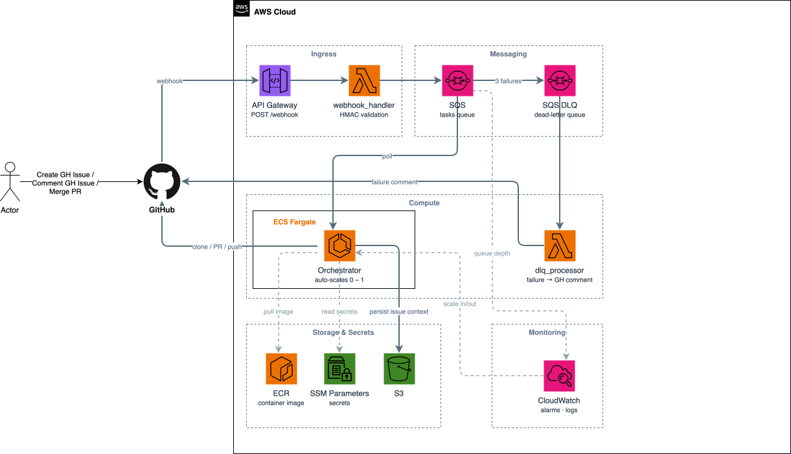
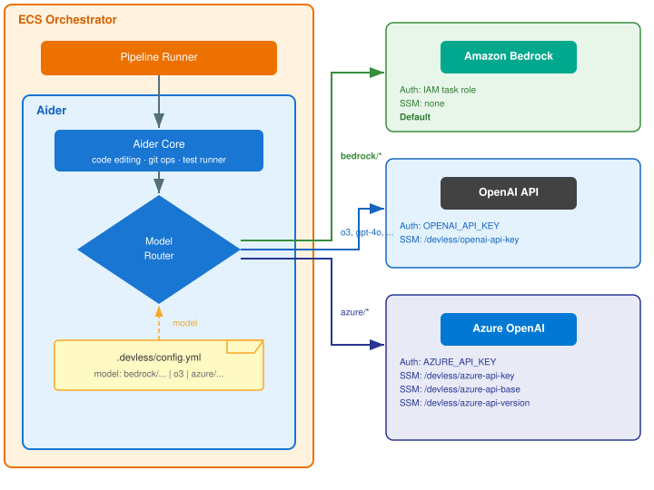

# Devless — Infrastructure

Automated coding agent that picks up GitHub issues, generates code changes with
Aider, and opens Pull Requests. Automatically fixes CI failures on its
own branches. PRs auto-merge after passing review and checks.

## Architecture



> To edit: open [`docs/architecture.drawio`](docs/architecture.drawio) in [draw.io](https://app.diagrams.net), then export as `architecture.drawio.svg` to update the rendered diagram.

Events handled:
- `issues` / `issue_comment` → full pipeline (clone → Aider → PR)
- `check_run` (failure on `issue-N` branches) → CI fix pipeline (checkout → Aider fix → push)

## How it works end-to-end

1. You open a GitHub issue describing a feature or bug fix
2. Webhook fires → Lambda validates HMAC → SQS message queued
3. ECS auto-scales from 0 → orchestrator picks up the message
4. Orchestrator clones repo, installs skills, runs Aider, opens PR
5. CI runs on the PR — if it fails, orchestrator auto-fixes and pushes
6. You review the PR — once approved + CI green, it auto-merges
7. ECS scales back to 0 when the queue is empty

---

## Deployment

There are two ways to deploy: automated via GitHub Actions (recommended) or
manually from your local machine.

### Option A: GitHub Actions (recommended)

Push to `main` and everything deploys automatically. One-time setup:

1. Create the S3 state bucket:

```bash
aws s3 mb s3://devless-tf-state --region eu-central-1
```

2. Do an initial `terraform apply` locally to create the OIDC role (chicken-and-egg):

```bash
cd terraform
cp terraform.tfvars.example terraform.tfvars
# Edit terraform.tfvars with your values (private key is handled separately)

# Save your GitHub App private key PEM file:
# pbpaste > github-app-private-key.pem   (or copy it however you prefer)

export TF_VAR_github_app_private_key="$(cat github-app-private-key.pem)"
terraform init
terraform apply
```

3. Note the `github_actions_role_arn` output and add these GitHub Actions secrets to this repo:

| Secret | Value |
|---|---|
| `AWS_REGION` | `eu-central-1` |
| `AWS_ROLE_ARN` | the `github_actions_role_arn` output |
| `TF_VAR_github_app_id` | your GitHub App ID |
| `TF_VAR_github_app_private_key` | your GitHub App private key (PEM) |
| `TF_VAR_github_app_installation_id` | your GitHub App installation ID |
| `TF_VAR_openai_api_key` | your OpenAI API key (optional, only for OpenAI backend) |
| `TF_VAR_webhook_secret` | your webhook HMAC secret |
| `TF_VAR_github_actions_org` | your GitHub org name |

4. Push to `main`. The `deploy.yml` workflow handles everything from now on:
   - `terraform apply` (infra changes)
   - Docker build + push to ECR
   - ECS redeployment

Every subsequent push to `main` deploys automatically. No manual steps.

### Option B: Manual deployment

If you prefer to deploy without CI/CD:

1. Create the S3 state bucket:

```bash
aws s3 mb s3://devless-tf-state --region eu-central-1
```

2. Create `terraform/terraform.tfvars` from the example:

```bash
cp terraform.tfvars.example terraform.tfvars
# Edit terraform.tfvars with your values
```

3. Deploy infrastructure:

```bash
cd terraform
export TF_VAR_github_app_private_key="$(cat github-app-private-key.pem)"
terraform init
terraform apply
```

4. Build and push the orchestrator image:

```bash
ECR_URL=$(terraform output -raw ecr_repository_url)

aws ecr get-login-password --region eu-central-1 | \
  docker login --username AWS --password-stdin "$ECR_URL"

docker build -t "$ECR_URL:latest" ../orchestrator/
docker push "$ECR_URL:latest"
```

5. Trigger ECS redeployment:

```bash
aws ecs update-service \
  --cluster devless-cluster \
  --service devless-orchestrator \
  --force-new-deployment \
  --region eu-central-1
```

Repeat steps 3–5 for every change.

---

## LLM backend configuration



> To edit: open [`docs/llm-backends.drawio`](docs/llm-backends.drawio) in [draw.io](https://app.diagrams.net), then export as `llm-backends.drawio.svg`.

Each target repo chooses its LLM backend via `.devless/config.yml`. The
orchestrator supports three providers. Only one needs to be configured.

---

### Option 1: Amazon Bedrock (default)

Authenticates via the ECS task IAM role — no API keys or SSM parameters needed.

The IAM module already includes `bedrock:InvokeModel` permission on the task
role. To verify or customize, see `terraform/modules/iam/main.tf`.

`.devless/config.yml`:

```yaml
model: bedrock/anthropic.claude-sonnet-4-20250514-v1:0
```

SSM setup: none.

---

### Option 2: OpenAI

Requires a single SSM parameter for the API key.

```bash
aws ssm put-parameter \
  --name "/devless/openai-api-key" \
  --type SecureString \
  --value "sk-..." \
  --region eu-central-1
```

Alternatively, set `TF_VAR_openai_api_key` as a GitHub Actions secret or
environment variable and let Terraform manage the parameter.

`.devless/config.yml`:

```yaml
model: o3
```

---

### Option 3: Azure OpenAI

Requires three SSM parameters.

```bash
aws ssm put-parameter \
  --name "/devless/azure-api-key" \
  --type SecureString \
  --value "your-azure-api-key" \
  --region eu-central-1

aws ssm put-parameter \
  --name "/devless/azure-api-base" \
  --type String \
  --value "https://your-resource.openai.azure.com" \
  --region eu-central-1

aws ssm put-parameter \
  --name "/devless/azure-api-version" \
  --type String \
  --value "2024-06-01" \
  --region eu-central-1
```

Then add the corresponding environment variables (`AZURE_API_KEY`,
`AZURE_API_BASE`, `AZURE_API_VERSION`) to the ECS task definition in
`terraform/modules/ecs/main.tf`.

`.devless/config.yml`:

```yaml
model: azure/gpt-4o
```

---

See [`examples/`](examples/) for ready-to-copy config files for each backend.

---

## Bootstrapping a target repository

Once the infrastructure is deployed, each repo you want Devless to work on
needs a one-time webhook registration and a CI workflow.

### Required: CI workflow

`.github/workflows/ci.yml` — must run on pull requests so Devless can detect
failures and auto-fix them. The actual steps depend on your language/stack:

```yaml
name: CI
on:
  pull_request:
jobs:
  test:
    runs-on: ubuntu-latest
    steps:
      - uses: actions/checkout@v4
      # Add your language-specific build/test steps here, e.g.:
      # Python:  pip install ".[test]" && pytest
      # Node.js: npm ci && npm test
      # Go:      go test ./...
      # Java:    mvn verify
      # Rust:    cargo test
      - run: <your-test-command>
```

### One-time: webhook registration

`.github/workflows/devless-setup.yml` — run once via Actions → Run workflow:

```yaml
name: Devless Setup
on:
  workflow_dispatch:
permissions:
  id-token: write
  contents: read
jobs:
  setup:
    runs-on: ubuntu-latest
    steps:
      - uses: typekpb/devless/.github/actions/devless-run@main
        with:
          aws_role_arn: ${{ secrets.AWS_ROLE_ARN }}
          api_gateway_url: ${{ secrets.DEVLESS_API_URL }}
          webhook_secret_param_name: /devless/webhook-secret
```

Add `AWS_ROLE_ARN` and `DEVLESS_API_URL` (the `api_gateway_url` terraform output)
as secrets in the target repo, then run the workflow.

### Optional: project config

`.devless/config.yml` — customize how Devless processes your repo:

```yaml
# Amazon Bedrock backend (default — uses ECS task role, no API key needed)
model: bedrock/anthropic.claude-sonnet-4-20250514-v1:0
test_command: npm test   # command Aider runs to verify changes (default: pytest)
max_iterations: 10       # max Aider retry loops (default: 10)
```

```yaml
# OpenAI backend (requires OPENAI_API_KEY on the orchestrator)
model: o3                # or: gpt-4o, o1, gpt-4-turbo
test_command: npm test
max_iterations: 10
```

```yaml
# Azure OpenAI backend (requires AZURE_API_KEY, AZURE_API_BASE, AZURE_API_VERSION)
model: azure/gpt-4o     # must match your Azure deployment name
test_command: npm test
max_iterations: 10
```

See [`examples/`](examples/) for ready-to-copy config files.

The `model` field uses Aider's model naming: `bedrock/<model-id>` for Bedrock
(default), plain name for OpenAI (e.g. `o3`), or `azure/<deployment-name>` for
Azure OpenAI. Bedrock authenticates via the ECS task role. OpenAI requires
`OPENAI_API_KEY`. Azure requires `AZURE_API_KEY`, `AZURE_API_BASE`, and
`AZURE_API_VERSION`.

The `test_command` should match whatever your CI runs. Examples:
- Python: `pytest`
- Node.js: `npm test`
- Go: `go test ./...`
- Java: `mvn test`
- Rust: `cargo test`
- Generic: `make test`

### Optional: repo-specific skills

```
.agents/skills/
  my-skill/
    SKILL.md
```

### Auto-merge setup

In the target repo settings:
1. Enable "Allow auto-merge" under General → Pull Requests
2. Add a branch protection rule on the default branch:
   - Require pull request reviews (at least 1 approval)
   - Require status checks to pass (select your CI workflow)

### Expected repo structure

Any language, any framework — just needs a CI workflow and optionally a config:

```
your-project/
├── .devless/config.yml           # Optional: model, test_command, max_iterations
├── .agents/skills/             # Optional: repo-specific Devless skills
├── .github/workflows/
│   ├── ci.yml                  # Required: runs your tests on PRs
│   └── devless-setup.yml         # One-time: registers the webhook
└── ...                         # Your code (any language/structure)
```

Then open an issue — Devless picks it up, posts status comments, opens a PR,
auto-fixes CI failures, and auto-merges after approval.

---

## Prerequisites

- AWS account with CLI configured
- Terraform >= 1.10
- Docker
- GitHub App (see setup below)
- OpenAI API key (only if using OpenAI backend instead of Bedrock)

---

## Creating the GitHub App

The orchestrator authenticates as a GitHub App to clone repos, open PRs, and
post comments. Apps use short-lived installation tokens — no PATs to rotate.

GitHub Apps can only be created via the web UI (there is no CLI command).

### Step 1: Create the app

1. Go to **Settings → Developer settings → GitHub Apps → New GitHub App**
   - Org-level: `https://github.com/organizations/typekpb/settings/apps/new`
   - Personal: `https://github.com/settings/apps/new`

2. Fill in:
   - **App name**: `Devless` (or any name you like)
   - **Homepage URL**: your repo URL (e.g. `https://github.com/typekpb/devless`)
   - **Webhook**: uncheck "Active" (the orchestrator doesn't receive webhooks via the app — it uses API Gateway)

3. Set **Repository permissions**:

   | Permission | Access |
   |---|---|
   | Contents | Read & write |
   | Issues | Read & write |
   | Pull requests | Read & write |
   | Checks | Read-only |
   | Metadata | Read-only (auto-granted) |

   No organization or account permissions are needed.

4. Under **Where can this GitHub App be installed?**, select "Only on this account".

5. Click **Create GitHub App**.

### Step 2: Generate a private key

1. On the app's settings page, scroll to **Private keys**
2. Click **Generate a private key**
3. A `.pem` file downloads — save it as `terraform/github-app-private-key.pem`

### Step 3: Note the App ID

The **App ID** is shown at the top of the app's settings page (a numeric value
like `123456`). You'll need this for `github_app_id` in Terraform.

### Step 4: Install the app

1. On the app's settings page, click **Install App** in the left sidebar
2. Choose your organization or account
3. Select **Only select repositories** and pick the repos Devless should work on
   (you can add more later)
4. Click **Install**

### Step 5: Get the Installation ID

After installing, the URL will look like:

```
https://github.com/organizations/typekpb/settings/installations/12345678
```

The number at the end (`12345678`) is your **Installation ID**. You'll need
this for `github_app_installation_id` in Terraform.

Alternatively, retrieve it via the API using the `gh` CLI:

```bash
APP_ID=123456  # your App ID from Step 3

# List installations (requires the app's JWT — easier to just grab from the URL above)
gh api "/app/installations" \
  --header "Authorization: Bearer $(gh auth token)" \
  | jq '.[].id'
```

### Summary of values

| Value | Where to find it | Terraform variable |
|---|---|---|
| App ID | App settings page, top | `github_app_id` |
| Private key | Downloaded `.pem` file | `TF_VAR_github_app_private_key` (env var) |
| Installation ID | URL after installing the app | `github_app_installation_id` |
