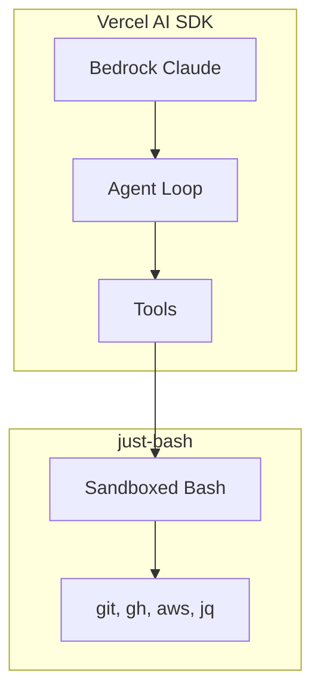
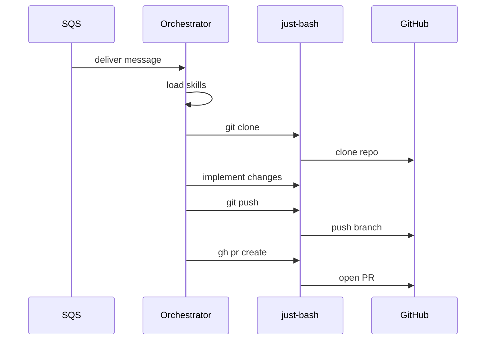

# orchestrator-bash

AI coding agent using [Vercel AI SDK](https://ai-sdk.dev/) + [just-bash](https://github.com/vercel-labs/just-bash) sandbox.

Alternative to the Python orchestrator — same functionality, simpler architecture.

## Architecture



## How it works



## Skills

Skills follow the Codex structure: `.agents/skills/<skill-name>/SKILL.md`

```
.agents/skills/
├── workflow/SKILL.md   # High-level orchestration
├── git/SKILL.md        # Clone, branch, commit, push
├── github/SKILL.md     # Issues, PRs, comments
├── files/SKILL.md      # Create, read, modify files
└── testing/SKILL.md    # Run tests from config
```

### Security Model

- No secrets passed to sandbox as environment variables
- GitHub token injected at network layer via just-bash transforms
- AWS operations (SQS, Bedrock) happen outside the sandbox
- Sandbox only has access to git, gh, and file operations

### Orchestrator vs Target Repo Skills

- **Orchestrator skills** (this folder): HOW to handle events
- **Target repo skills** (in processed repos): WHAT code conventions to follow

## Structure

```
orchestrator-bash/
├── src/
│   ├── index.ts        # Entry point (SQS polling + CLI)
│   ├── handler.ts      # AI agent with just-bash tool
│   └── skills.ts       # Skills loader
├── .agents/skills/     # Orchestrator skills
├── config.yml          # Model and agent config
├── Dockerfile
└── package.json
```

## Usage

### SQS Polling Mode (Production)
```bash
bun install
bun start
```

### CLI Mode (Testing)
```bash
bun src/index.ts issue typekpb/devless-demo 42
```

### Local Development
Copy `.env.example` to `.env` and fill in your values:
```bash
cp .env.example .env
# Edit .env with your credentials
bun run dev
```

## Configuration

`config.yml`:
```yaml
model: anthropic.claude-3-haiku-20240307-v1:0
max_steps: 20
poll_interval: 10
```

## Requirements

- Bun 1.0+
- AWS credentials (for Bedrock)
- GitHub App credentials (App ID, private key, installation ID)
