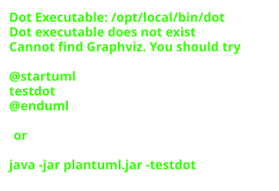
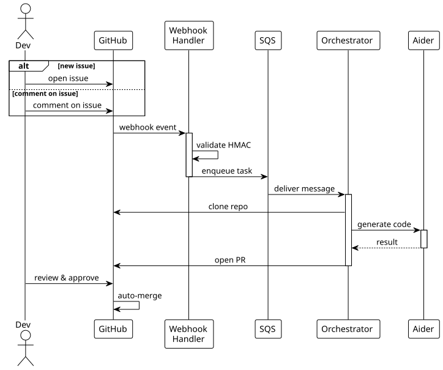

# orchestrator

AI coding agent using Python + [Aider](https://aider.chat/).

Main orchestrator implementation with state machine pipeline.

## Architecture



## How it works



## Structure

```
orchestrator/
├── src/
│   ├── main.py           # Entry point
│   ├── sqs_consumer.py   # SQS polling
│   ├── pipeline/
│   │   ├── runner.py     # Message routing
│   │   └── stages.py     # State machine
│   ├── aider_runner.py   # Aider integration
│   ├── repo_manager.py   # Git operations
│   ├── pr_manager.py     # PR creation
│   └── issue_manager.py  # Issue comments
├── tests/
├── Dockerfile
└── pyproject.toml
```

## Usage

### SQS Polling Mode (Production)
```bash
pip install -e .
export SQS_QUEUE_URL="https://sqs..."
export S3_BUCKET="devless-checkpoints"
export GITHUB_APP_ID="..."
export GITHUB_APP_PRIVATE_KEY="$(cat key.pem)"
export GITHUB_APP_INSTALLATION_ID="..."
python -m main
```

### Local Testing
```bash
cd /tmp && git clone https://github.com/typekpb/devless-demo.git && cd devless-demo
aider --model bedrock/eu.anthropic.claude-sonnet-4-20250514-v1:0 \
  --message "Describe the change"
```

## Configuration

Target repos configure via `.devless/config.yml`:
```yaml
model: bedrock/eu.anthropic.claude-sonnet-4-20250514-v1:0
test_command: npm test
max_iterations: 10
```

## Requirements

- Python 3.11 or 3.12
- aider-chat
- AWS credentials (for Bedrock, SQS, S3)
- GitHub App credentials
