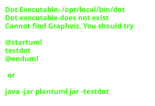

# Devless
## AI-Powered Code Generation from GitHub Issues

*An army of AI workers at your service*

⚠️ **This is a Proof of Concept** ⚠️

by Peter Butkovic (peter.butkovic@nordcloud.com)

---

# The Problem

## Problem to solve

- Create issues → get working code
- Review-ready PRs
- Respond to PR comments, iterate

## Ideal scenario

> Open issue → AI implements → PR opens → Review → Merge

---

# Available Tools

| Tool | Status | Notes |
|------|--------|-------|
| **GitHub Copilot Agent** | ✅ Tested | Works well, zero setup |
| **Devin** | ❓ Not tested | $500/mo |
| **SWE-agent** | ❓ Not tested | DIY setup |
| **Aider** | ✅ Used | CLI, no GitHub integration |

**Motivation for POC:** AWS/Bedrock self hosted solution. How hard is it?

---

# Solution: Devless


Issue → Webhook → SQS → Orchestrator → Aider → PR

---

# Two Orchestrator Approaches

## 1. State Machine (Original)
- Python code controls flow
- Explicit states: `pending → cloned → agent_loop → pr_created`
- ~800 lines of code

## 2. Agent-based (Strands)
- LLM decides flow via SKILL.md files
- Tools for git/GitHub/code operations
- ~400 lines of code

---

# State Machine Approach


**Pros:** Deterministic, easy to debug
**Cons:** Rigid, code changes for new workflows

---

# Agent-based Approach



**Pros:** Flexible, edit SKILL.md for changes
**Cons:** LLM behavior may vary

---

# Comparison: Two Approaches

| Aspect | State Machine | Agent-based |
|--------|--------------|-------------|
| Control flow | Hardcoded Python | LLM via SKILL.md |
| Lines of code | ~800 | ~400 |
| Adding workflows | Code changes | Edit SKILL.md |
| Error handling | try/except | Agent decides |
| Predictability | ✅ Deterministic | ⚠️ May vary |
| Flexibility | ⚠️ Rigid | ✅ Adapts |
| Secrets | Hidden | Hidden in tools |

---

# Security: Secrets Handling

## Both approaches hide secrets from LLM

**State Machine:** Orchestrator holds token, never passes to Aider

**Agent-based:** Tools initialized with token at startup
- LLM calls `create_pr(title, body)` 
- Tool internally uses token
- Token never in LLM context

---

# vs GitHub Copilot Agent

| Aspect | Devless | Copilot Agent |
|--------|---------|---------------|
| Setup | Terraform deploy | ✅ Zero |
| Cost | ~$20/mo | GitHub sub |
| LLM choice | Bedrock, OpenAI | GitHub only |
| Customization | Full control | Limited |
| Self-hosted | ✅ Yes | ❌ No |
| Data residency | Your AWS | GitHub |
| Maintenance | You | GitHub |

---

# Demo

**Repo:** [github.com/typekpb/devless-demo](https://github.com/typekpb/devless-demo)

1. Open issue describing feature
2. Devless posts status comment
3. PR opens with implementation
4. Review, comment, iterate
5. Merge

---

# Target Repo Setup

`.devless/config.yml`:
```yaml
model: bedrock/eu.anthropic.claude-sonnet-4-20250514-v1:0
test_command: npm test
```

Webhook events: Issues, Issue comments, PR reviews

That's it. No agents to install.

---

# Infrastructure

```
terraform/
├── modules/
│   ├── api_gateway/   # Webhook endpoint
│   ├── lambda/        # HMAC validation
│   ├── sqs/           # Task queue
│   ├── ecs/           # Orchestrator
│   └── iam/           # Roles
```

One `terraform apply` deploys everything.

---

# Development Cost & Timeline

| Item | Value |
|------|-------|
| Kiro subscription | $20 |
| AWS sandbox | $0 |
| Kiro credits used | ~900 (free 50 ran out fast) |

---

# Lessons Learned

## What worked ✅
- Aider — battle-tested
- GitHub App auth — no PATs
- Bedrock — zero config with IAM

## Key insight

- State machines feel safe but become rigid.
- Agent + tools = less code, same control.

---

# Lessons Learned

## Model matters ⚠️
- Haiku got stuck on simple TypeScript error (unused import)
- Kept adding `import React` instead of removing it
- Sonnet understood the fix immediately

**Recommendation:** Start with agent-based, use Sonnet or better.

---

# Coding Styles Comparison

| Style | Feedback Loop | Best For | Target Users |
|-------|---------------|----------|--------------|
| **Vibe coding** | ✅ Instant | Quick prototypes | Developers |
| **Specs (Kiro)** | ⚠️ Upfront planning | New projects only | Architects, PMs |
| **GitHub Issues** | ⚠️ Slower | Existing projects | Non-devs, PMs |

---

# Coding Styles Comparison

## Specs approach
- Nice for planning ahead
- But feels like waterfall 🚫
- Only works for greenfield projects

## GitHub Issues approach
- Slower feedback (wait for PR)
- **Enables non-developers** to request features
- **Enhancement idea:** Stream Aider output to issue comments

---

# Q&A

**Devless:** [github.com/typekpb/devless](https://github.com/typekpb/devless)

**Demo:** [github.com/typekpb/devless-demo](https://github.com/typekpb/devless-demo)
